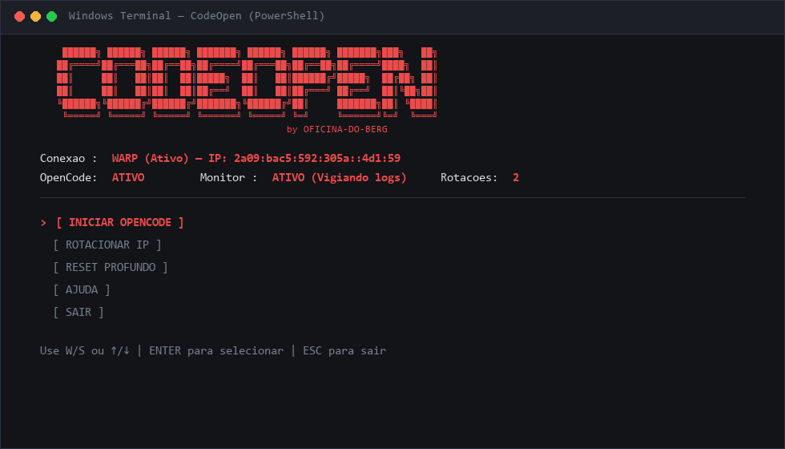
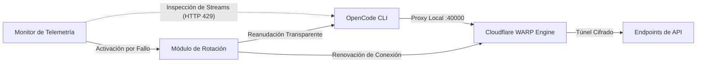

<div align="center">

# CodeOpenFreedom
### Capa de Conectividad y Resiliencia para OpenCode CLI
**Desarrollado por OFICINA-DO-BERG**

<p align="center">
  <a href="README.md">English</a> •
  <a href="README.pt-BR.md">Português</a> •
  <b>Español</b>
</p>

<p align="center">
  <a href="https://github.com/Oficina-do-Berg/CodeOpenFreedom/blob/main/LICENSE">
    
  </a>
  
  
  
  
</p>

<p align="center">
  <a href="#visión-general">Visión General</a> •
  <a href="#características-principales">Características Principales</a> •
  <a href="#comparativa-técnica">Comparativa</a> •
  <a href="#arquitectura-del-sistema">Arquitectura</a> •
  <a href="#instalación-y-requisitos">Instalación</a> •
  <a href="#guía-de-uso">Uso</a> •
  <a href="#aviso-legal">Aviso Legal</a>
</p>

<br>

<p align="center">
  
</p>

</div>

---

## Visión General

**CodeOpenFreedom** es una capa automatizada de resiliencia y gestión de conectividad diseñada para desarrolladores de software que utilizan la interfaz de línea de comandos de **OpenCode** en sistemas Windows.

Operando de manera transparente entre el terminal y los puntos de conexión externos (APIs), la herramienta establece un túnel proxy local mediante **Cloudflare WARP (puerto local 40000)**, monitoriza flujos de telemetría en tiempo real y mitiga interrupciones provocadas por el agotamiento temporal de límites de solicitudes (HTTP 429), garantizando la continuidad ininterrumpida de sus flujos de trabajo de ingeniería.

---

## Características Principales

<table>
  <tr>
    <td width="50%" valign="top">
      <h4>Rotación Dinámica de Conexión</h4>
      <p>Supervisión continua de códigos de error de respuesta (incluidos <code>HTTP 429</code>, <code>rate limit exceeded</code> o <code>too many requests</code>). Al detectar saturación, el subsistema orquesta una renovación de registro y establece una nueva ruta en aproximadamente 15 segundos sin cerrar el terminal activo.</p>
    </td>
    <td width="50%" valign="top">
      <h4>Aislamiento y Respaldo de Sesiones</h4>
      <p>Procedimiento de reinicio controlado con salvaguarda preventiva. El historial de sesiones y las bases de datos locales se archivan automáticamente con marca temporal (timestamp) en una carpeta dedicada del Escritorio antes de cualquier purga de credenciales.</p>
    </td>
  </tr>
  <tr>
    <td width="50%" valign="top">
      <h4>Orquestación Automatizada</h4>
      <p>Elimina comandos de red manuales y repetitivos. CodeOpenFreedom gestiona el modo proxy y la asignación del puerto local 40000 de forma autónoma, validando la integridad del túnel antes de iniciar los procesos dependientes.</p>
    </td>
    <td width="50%" valign="top">
      <h4>Interfaz TUI Optimizada</h4>
      <p>Diseñada para alta respuesta en Windows Terminal y PowerShell nativo. Presenta telemetría continua con indicadores en tiempo real del estado de conexión, dirección IP en tránsito y actividad del daemon supervisor.</p>
    </td>
  </tr>
</table>

---

## Comparativa Técnica

La siguiente tabla resume las diferencias operativas entre la ejecución estándar de OpenCode CLI y la arquitectura gestionada por CodeOpenFreedom:

| Escenario Operativo | Flujo Estándar (Sin CodeOpenFreedom) | Con CodeOpenFreedom |
| :--- | :--- | :--- |
| **Agotamiento de Tasa (HTTP 429)** | Flujo detenido; requiere espera indeterminada | Rotación automática de ruta en ~15 segundos |
| **Agotamiento de Cuota** | Interrupción manual del flujo de desarrollo | Reinicio controlado con nueva ruta y datos protegidos |
| **Integridad de Datos** | Riesgo de pérdida de historial en limpiezas manuales | Respaldo automático estructurado con marca temporal |
| **Configuración de Proxy** | Ejecución manual de comandos en la consola | Enrutamiento autónomo a través del puerto local 40000 |
| **Estabilidad Visual** | Terminal susceptible a parpadeos y congelamiento | TUI asíncrona, suave y estable en Windows Terminal |

---

## Arquitectura del Sistema



---

## Instalación y Requisitos

### Requisitos Previos
* **Sistema Operativo:** Windows 10 o Windows 11 (64-bit)
* **Python:** Versión 3.8 o superior ([Descargar Python](https://www.python.org/downloads/))
* **Cloudflare WARP:** Cliente oficial instalado ([Descargar WARP](https://1.1.1.1/))
* **OpenCode CLI:** Instalado globalmente mediante npm (`npm install -g @opencode/cli`)

> [!IMPORTANT]
> **Paso Obligatorio Antes de Ejecutar el Script:**  
> Abra la aplicación oficial de **Cloudflare WARP** en Windows y asegúrese de **activarla (conectar)** antes de iniciar CodeOpenFreedom. El script interactúa directamente con el daemon en ejecución de WARP para habilitar el proxy local en el puerto 40000 y gestionar las renovaciones automáticas de IP.

### Pasos de Instalación

1. Clone el repositorio localmente:
```cmd
git clone https://github.com/Oficina-do-Berg/CodeOpenFreedom.git
cd CodeOpenFreedom
```

2. Ejecute el instalador automatizado:
```cmd
INSTALAR.bat
```
> Alternativamente, instale las dependencias manualmente: `pip install -r requirements.txt`

---

## Guía de Uso

### Inicio de la Aplicación

> [!NOTE]
> Recuerde abrir **Cloudflare WARP** y dejarlo **conectado** en Windows antes de ejecutar el iniciador.

Para cargar el panel interactivo, ejecute:
```cmd
INICIAR.bat
```
*(O ejecute directamente `python main.py` desde su emulador de terminal preferido).*

### Panel de Control Interactivo

```text
┌────────────────────────────────────────────────────────────┐
│                    CODEOPENFREEDOM                         │
│                   OFICINA DO BERG                          │
│                                                            │
│   Conexion: WARP (2a09:bac5:...) | OpenCode: ACTIVO        │
├────────────────────────────────────────────────────────────┤
│                                                            │
│   > [ INICIAR OPENCODE ]  (o [ DETENER OPENCODE ])         │
│     [ ROTAR IP ]                                           │
│     [ REINICIO PROFUNDO ]                                  │
│     [ AYUDA ]                                              │
│     [ SALIR ]                                              │
│                                                            │
└────────────────────────────────────────────────────────────┘
```

### Controles de Navegación

| Tecla de Entrada | Acción |
| :---: | :--- |
| **W** o **Flecha Arriba (↑)** | Desplazar selección hacia arriba |
| **S** o **Flecha Abajo (↓)** | Desplazar selección hacia abajo |
| **ENTER** | Confirmar y ejecutar la opción seleccionada |
| **ESC** | Salir de la aplicación de forma segura |

---

## Estructura del Repositorio

```text
CodeOpenFreedom/
├── assets/
│   └── terminal-preview.png # Muestra visual de alta resolución de la interfaz TUI
├── core/
│   ├── config.py            # Parámetros locales y persistencia de configuración
│   ├── connection.py        # Automatización de interfaces de red y Cloudflare WARP CLI
│   ├── opencode.py          # Gestión del ciclo de vida del proceso y respaldos
│   ├── rotator.py           # Orquestador de failover y rotación dinámica de IP
│   ├── monitor.py           # Hilo de observabilidad y captura de patrones de error
│   └── orchestrator.py      # Controlador maestro de procesos y eventos
├── utils/
│   ├── logger.py            # Subsistema rotativo de registro de eventos
│   └── helpers.py           # Validadores de conectividad y comprobación de red
├── cli.py                   # Motor de renderizado TUI e interfaz interactiva
├── main.py                  # Punto de entrada estándar en Python
├── select_language.py       # Selector de idioma inicial (PT / EN)
├── INICIAR.bat              # Lanzador ejecutable en lote de un solo clic
├── INSTALAR.bat             # Verificador de entorno e instalador de dependencias
├── requirements.txt         # Requisitos mínimos de dependencias (psutil, requests)
├── test_sistema.py          # Diagnóstico ambiental y comprobación de salud
├── test_reset.py            # Validación de rutinas de reinicio y respaldo
└── README.md                # Documentación técnica oficial (Inglés por defecto)
```

---

## Preguntas Frecuentes

<details>
<summary><strong>¿Es necesario abrir y conectar Cloudflare WARP antes de iniciar el script?</strong></summary>
<br>
<strong>Sí, obligatorio.</strong> La aplicación oficial de Cloudflare WARP debe estar abierta y conectada en Windows antes de ejecutar el script. CodeOpenFreedom utiliza el daemon activo de WARP para configurar el proxy local en el puerto 40000 y gestionar las renovaciones automáticas de IP.
</details>

<details>
<summary><strong>¿Es necesario configurar puertos o proxies manualmente?</strong></summary>
<br>
No. CodeOpenFreedom configura de forma autónoma el modo proxy local en el puerto 40000 e inyecta las variables de entorno necesarias. Solo requiere que el cliente de WARP esté en ejecución y conectado.
</details>

<details>
<summary><strong>¿La rutina de Reinicio Profundo borra el historial de conversaciones?</strong></summary>
<br>
No de forma destructiva. Antes de cualquier limpieza de credenciales o caché local, el sistema genera un respaldo completo con marca temporal de las bases de datos de sesión en <code>Escritorio\opencode_chats_archiviate\&lt;marca_temporal&gt;</code>.
</details>

<details>
<summary><strong>¿Qué emulador de terminal se recomienda para su ejecución?</strong></summary>
<br>
Se recomienda utilizar <strong>Windows Terminal</strong> (disponible gratuitamente en Microsoft Store), ya que ofrece soporte completo para secuencias de escape ANSI modernas, aceleración por GPU y renderizado sin parpadeos.
</details>

---

## Créditos

* **Desarrollo y Mantenimiento:** [OFICINA-DO-BERG](https://github.com/Oficina-do-Berg)
* **Inspiración Conceptual:** Iniciativas de código abierto para automatización de OpenCode CLI

---

## Licencia

Este proyecto se distribuye bajo los términos de la licencia **GPL-3.0**. Consulte el archivo [LICENSE](LICENSE) para obtener detalles completos sobre derechos de modificación y distribución.

---

## Aviso Legal

Este software es una utilidad de código abierto desarrollada con fines estrictamente técnicos, educativos y de gestión de conectividad local. No cuenta con afiliación, patrocinio ni respaldo oficial por parte de proveedores de servicios externos mencionados. El usuario final asume la responsabilidad exclusiva de su uso de conformidad con los términos y políticas aplicables.
