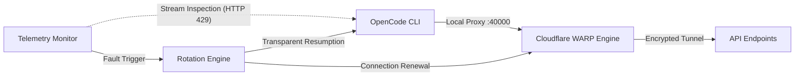

<div align="center">

# CodeOpenFreedom
### Connectivity & Resilience Management Layer for OpenCode CLI
**Developed by OFICINA-DO-BERG**

<p align="center">
  <b>English</b> •
  <a href="README.pt-BR.md">Português</a> •
  <a href="README.es.md">Español</a>
</p>

<p align="center">
  <a href="https://github.com/Oficina-do-Berg/CodeOpenFreedom/blob/main/LICENSE">
    
  </a>
  
  
  
  
</p>

<p align="center">
  <a href="#overview">Overview</a> •
  <a href="#core-features">Core Features</a> •
  <a href="#technical-comparison">Comparison</a> •
  <a href="#system-architecture">Architecture</a> •
  <a href="#installation--requirements">Installation</a> •
  <a href="#usage-guide">Usage</a> •
  <a href="#legal-disclaimer">Disclaimer</a>
</p>

<br>

<p align="center">
  
</p>

</div>

---

## Overview

**CodeOpenFreedom** is an automated resilience and connectivity management layer engineered for software developers utilizing the **OpenCode CLI** on Windows systems.

Operating transparently between the local console and external API endpoints, the application provisions a dedicated local proxy tunnel via **Cloudflare WARP (local port 40000)**, monitors runtime telemetry streams in real time, and automatically mitigates disruptions caused by temporary request rate limits (HTTP 429), ensuring seamless continuity in engineering workflows.

---

## Core Features

<table>
  <tr>
    <td width="50%" valign="top">
      <h4>Dynamic Connection Failover</h4>
      <p>Continuous monitoring of upstream error codes (including <code>HTTP 429</code>, <code>rate limit exceeded</code>, or <code>too many requests</code>). Upon detecting saturation, the subsystem orchestrates a registration renewal and establishes a new network path in approximately 15 seconds without terminating your active terminal session.</p>
    </td>
    <td width="50%" valign="top">
      <h4>Session Isolation & Backup</h4>
      <p>Controlled emergency reset routine with preventative safeguards. Session histories and local workspace databases are automatically archived with ISO timestamps to a dedicated desktop folder before any operational credential flush occurs.</p>
    </td>
  </tr>
  <tr>
    <td width="50%" valign="top">
      <h4>Automated Tunnel Orchestration</h4>
      <p>Eliminates repetitive manual network commands. CodeOpenFreedom manages proxy mode parameters and local port allocation autonomously, validating interface integrity before initiating downstream processes.</p>
    </td>
    <td width="50%" valign="top">
      <h4>High-Performance TUI</h4>
      <p>Optimized for Windows Terminal and native PowerShell environments. Features asynchronous telemetry rendering with live indicators for tunnel status, egress IP address, and supervisor daemon activity.</p>
    </td>
  </tr>
</table>

---

## Technical Comparison

The table below contrasts standard OpenCode CLI operation against the managed architecture provided by CodeOpenFreedom:

| Operational Scenario | Standard Workflow (Without CodeOpenFreedom) | With CodeOpenFreedom |
| :--- | :--- | :--- |
| **Rate Limit Exceeded (HTTP 429)** | Workflow halted; requires indeterminate idle wait | Automated route failover in ~15 seconds |
| **Quota Depletion** | Manual interruption and loss of development velocity | Controlled credential reset with fresh route & safe data archive |
| **Data Integrity** | High risk of chat history loss during manual cleanup | Automatic timestamped backup archive to Desktop |
| **Proxy Configuration** | Manual execution of console network commands | Autonomous, transparent routing on local port 40000 |
| **Interface Stability** | Terminal susceptible to flicker and thread locking | Smooth, flicker-free ANSI TUI on Windows Terminal |

---

## System Architecture



---

## Installation & Requirements

### Prerequisites
* **Operating System:** Windows 10 or Windows 11 (64-bit)
* **Python:** Version 3.8 or higher ([Download Python](https://www.python.org/downloads/))
* **Cloudflare WARP:** Official desktop client installed ([Download WARP](https://1.1.1.1/))
* **OpenCode CLI:** Installed globally via npm (`npm install -g @opencode/cli`)

> [!IMPORTANT]
> **Mandatory Step Before Running the Script:**  
> Open the official **Cloudflare WARP** desktop client on Windows and ensure it is **connected (turned ON)** before launching CodeOpenFreedom. The script interfaces directly with the active WARP daemon to configure the local proxy on port 40000 and orchestrate automated IP renewals.

### Installation Steps

1. Clone the repository locally:
```cmd
git clone https://github.com/Oficina-do-Berg/CodeOpenFreedom.git
cd CodeOpenFreedom
```

2. Run the automated installer:
```cmd
INSTALAR.bat
```
> Alternatively, install dependencies manually: `pip install -r requirements.txt`

---

## Usage Guide

### Starting the Application

> [!NOTE]
> Make sure **Cloudflare WARP** is open and **connected** in Windows before executing the launcher.

To launch the interactive control panel, execute:
```cmd
INICIAR.bat
```
*(Or run `python main.py` directly from your preferred terminal emulator).*

### Interactive Control Panel

```text
┌────────────────────────────────────────────────────────────┐
│                    CODEOPENFREEDOM                         │
│                   OFICINA DO BERG                          │
│                                                            │
│   Connection: WARP (2a09:bac5:...) | OpenCode: ACTIVE      │
├────────────────────────────────────────────────────────────┤
│                                                            │
│   > [ START OPENCODE ]  (or [ STOP OPENCODE ])             │
│     [ ROTATE IP ]                                          │
│     [ DEEP RESET ]                                         │
│     [ HELP ]                                               │
│     [ EXIT ]                                               │
│                                                            │
└────────────────────────────────────────────────────────────┘
```

### Keyboard Navigation

| Key Input | Action |
| :---: | :--- |
| **W** or **Up Arrow (↑)** | Move selection upward |
| **S** or **Down Arrow (↓)** | Move selection downward |
| **ENTER** | Confirm and execute the selected module |
| **ESC** | Safely exit the application |

---

## Repository Layout

```text
CodeOpenFreedom/
├── assets/
│   └── terminal-preview.png # High-definition preview of the TUI interface
├── core/
│   ├── config.py            # Local parameters and configuration persistence
│   ├── connection.py        # Network interface automation & Cloudflare WARP CLI
│   ├── opencode.py          # Process lifecycle management & session backups
│   ├── rotator.py           # Failover orchestrator & dynamic IP rotation
│   ├── monitor.py           # Stream observability thread & error pattern regex
│   └── orchestrator.py      # Master process controller & event coordinator
├── utils/
│   ├── logger.py            # Rotating event logging subsystem
│   └── helpers.py           # Network validation and connectivity helpers
├── cli.py                   # TUI rendering engine and interactive loop
├── main.py                  # Standard Python entrypoint
├── select_language.py       # Startup language selector (PT / EN)
├── INICIAR.bat              # Quick one-click execution batch launcher
├── INSTALAR.bat             # Dependency setup and environment validator
├── requirements.txt         # Minimal dependency specifications (psutil, requests)
├── test_sistema.py          # Environmental diagnostics and health check script
├── test_reset.py            # Validation script for deep reset and backup routines
└── README.md                # Official technical documentation
```

---

## Frequently Asked Questions

<details>
<summary><strong>Do I need to open and connect Cloudflare WARP before running the script?</strong></summary>
<br>
<strong>Yes, mandatory.</strong> The official Cloudflare WARP client must be open and connected on Windows prior to launching the script. CodeOpenFreedom communicates directly with the active WARP daemon to enable the local proxy on port 40000 and handle automatic route renewals.
</details>

<details>
<summary><strong>Do I need to configure ports or proxy parameters manually?</strong></summary>
<br>
No. CodeOpenFreedom autonomously configures the local proxy mode on port 40000 and injects required runtime environment variables. You only need the official WARP desktop client running and connected.
</details>

<details>
<summary><strong>Does the Deep Reset routine permanently destroy previous sessions?</strong></summary>
<br>
No. Before any local credential or cache clearance, the system creates a full timestamped backup archive of your session databases under <code>Desktop\opencode_chats_archiviate\&lt;timestamp&gt;</code>.
</details>

<details>
<summary><strong>Which terminal emulator provides the best experience?</strong></summary>
<br>
We recommend <strong>Windows Terminal</strong> (free on Microsoft Store), which supports modern ANSI escape codes, hardware-accelerated text rendering, and zero-flicker display updates.
</details>

---

## Credits

* **Development & Maintenance:** [OFICINA-DO-BERG](https://github.com/Oficina-do-Berg)
* **Conceptual Inspiration:** Open-source OpenCode CLI automation initiatives

---

## License

This project is distributed under the terms of the **GPL-3.0** License. Refer to the [LICENSE](LICENSE) file for complete redistribution and modification rights.

---

## Legal Disclaimer

This software is an independent, open-source utility developed strictly for technical research, educational resilience testing, and local network proxy management. It is not affiliated with, sponsored by, or endorsed by any third-party service providers mentioned. The end user maintains sole responsibility for ensuring compliant use in accordance with applicable service terms.
