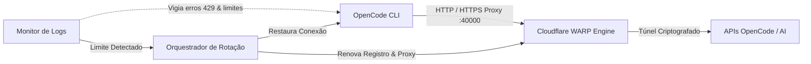

<div align="center">

# ⚡ CodeOpenFreedom
### *Smart Connection Manager & Rate Limit Recovery for OpenCode CLI*
**Desenvolvido com excelência por OFICINA-DO-BERG**

<p align="center">
  <a href="https://github.com/Oficina-do-Berg/CodeOpenFreedom/blob/main/LICENSE">
    
  </a>
  
  
  
  
</p>

> **Diga adeus às pausas forçadas por limites de requisições, cotas esgotadas e erros HTTP 429 no OpenCode.**

[Instalação Rápida](#-instalação-rápida) • [Como Funciona](#-como-funciona) • [Funcionalidades](#-cards-de-funcionalidades) • [Comparativo](#-comparativo) • [Aviso Legal](#-aviso-legal-disclaimer)

---

</div>

## 📌 Visão Geral

O **CodeOpenFreedom** é um gerenciador de conexões leve, modular e automatizado para desenvolvedores que utilizam o **OpenCode**. 

Ele atua como uma camada inteligente entre a sua máquina e as APIs do OpenCode: roteia as requisições através de um proxy local no **Cloudflare WARP (porta 40000)**, monitora logs em tempo real e reage instantaneamente a qualquer bloqueio ou cota excedida, mantendo o seu fluxo de programação 100% contínuo.

---

## 🎴 Cards de Funcionalidades

<table>
  <tr>
    <td width="50%" valign="top">
      <h3>🔄 Rotação Automática de IP</h3>
      Ao detectar erros de taxa (<strong>HTTP 429</strong>, <em>rate limit exceeded</em> ou <em>too many requests</em>), o motor renova a identidade Cloudflare e estabelece uma nova rota em ~15 segundos sem fechar seu terminal.
    </td>
    <td width="50%" valign="top">
      <h3>⚡ Deep Reset com Proteção</h3>
      Quando a cota da conta esgota, o app faz backup do seu banco de dados de conversas (<code>opencode.db</code>) no <strong>Desktop</strong>, renova tokens e zera o contador para um novo início limpo.
    </td>
  </tr>
  <tr>
    <td width="50%" valign="top">
      <h3>🤖 Modo Piloto Automático</h3>
      Com apenas 1 clique em <code>[ INICIAR OPENCODE ]</code>, o aplicativo liga o túnel WARP, inicia o OpenCode e ativa um vigia em thread paralela para que você programe sem interrupções.
    </td>
    <td width="50%" valign="top">
      <h3>🛡️ Zero Configuração Manual</h3>
      O aplicativo executa todos os comandos de rede (<code>mode proxy</code> e <code>proxy port 40000</code>) de forma 100% automática. Instale o WARP oficial e deixe o CodeOpen cuidar do resto.
    </td>
  </tr>
</table>

---

## 📊 Comparativo: Por que usar o CodeOpenFreedom?

| Desafio | Sem o CodeOpenFreedom ❌ | Com o CodeOpenFreedom ⚡ |
| :--- | :--- | :--- |
| **Erro 429 (Rate Limit)** | Trabalho bloqueado por horas ou dias | IP rotacionado em 15 segundos automaticamente |
| **Cota Esgotada** | Perda de tempo esperando renovação | Deep reset seguro com novo IP e histórico preservado |
| **Segurança das Conversas** | Risco de corromper ou perder chats antigos | Backup automático com timestamp no Desktop |
| **Configuração de Proxy** | Comandos manuais chatos no terminal | 100% automatizado na porta local 40000 |
| **Interface do Usuário** | Terminal que trava ou pisca | TUI nativa e suave (Windows Terminal / PowerShell) |

---

## 🏗️ Arquitetura do Sistema



---

## 🚀 Instalação Rápida

### 1️⃣ Pré-requisitos
* **Python 3.8+** ([Download](https://www.python.org/downloads/))
* **Cloudflare WARP** ([Download Gratuito](https://1.1.1.1/)) — *Instale e abra-o pelo menos uma vez.*
* **OpenCode CLI** (`npm install -g @opencode/cli`)

### 2️⃣ Instalar Dependências (1 Clique)
Basta dar dois cliques no instalador do projeto:
```bat
INSTALAR.bat
```
> *Ou manualmente via terminal:* `pip install -r requirements.txt`

---

## 🎮 Como Usar

### Início Rápido (Recomendado)
Dê dois cliques no inicializador:
```bat
INICIAR.bat
```
*(Ou execute `python main.py` no seu terminal)*

### Menu Interativo

```text
┌────────────────────────────────────────────────────────────┐
│                    CODEOPENFREEDOM                         │
│                   by OFICINA-DO-BERG                       │
│                                                            │
│   Conexao: WARP (2a09:bac5:...) | OpenCode: ATIVO          │
├────────────────────────────────────────────────────────────┤
│                                                            │
│   > [ 🟢 INICIAR OPENCODE ]  (ou [ 🔴 PARAR OPENCODE ])    │
│     [ 🔄 ROTACIONAR IP ]                                   │
│     [ ⚠️ RESET PROFUNDO ]                                  │
│     [ 💡 AJUDA ]                                           │
│     [ 🚪 SAIR ]                                            │
│                                                            │
└────────────────────────────────────────────────────────────┘
```

### ⌨️ Controles
| Tecla | Função |
| :---: | :--- |
| **W** ou **↑** | Subir seleção no menu |
| **S** ou **↓** | Descer seleção no menu |
| **ENTER** | Executar opção selecionada |
| **ESC** | Sair do aplicativo |

---

## 📂 Estrutura do Projeto

```text
opencode-infinity-simple/
├── core/
│   ├── config.py          # Configurações do app e persistência
│   ├── connection.py      # Automação de rede e Cloudflare WARP CLI
│   ├── opencode.py        # Ciclo de vida do OpenCode, auth e banco de chats
│   ├── rotator.py         # Motor de rotação e contingência
│   ├── monitor.py         # Vigia de logs multithread (11 padrões de erro)
│   └── orchestrator.py    # Orquestrador do fluxo automático
├── utils/
│   ├── logger.py          # Sistema de logs com rotação
│   └── helpers.py         # Validadores de IP e rede
├── cli.py                 # Interface do menu interativo
├── main.py                # Ponto de entrada padrão Python
├── select_language.py     # Seletor interativo de idioma (PT/EN)
├── INICIAR.bat            # Launcher rápido de 1 clique
├── INSTALAR.bat           # Instalador automático de dependências
├── requirements.txt       # Dependências essenciais (psutil, requests)
├── test_sistema.py        # Script de diagnóstico geral do sistema
├── test_reset.py          # Script de validação do Deep Reset
└── README.md              # Documentação oficial
```

---

## ❓ Perguntas Frequentes (FAQ)

<details>
<summary><strong>Preciso configurar a porta 40000 ou proxy manualmente no WARP?</strong></summary>
<br>
<strong>Não!</strong> O CodeOpenFreedom envia os comandos <code>warp-cli mode proxy</code> e <code>warp-cli proxy port 40000</code> de forma invisível. Você só precisa ter o app do WARP instalado no seu Windows.
</details>

<details>
<summary><strong>O Deep Reset apaga as minhas conversas anteriores?</strong></summary>
<br>
<strong>Não!</strong> Antes de resetar as credenciais da conta, o aplicativo copia e move com segurança o seu banco de dados de conversas para a pasta <code>Desktop\opencode_chats_archiviate\&lt;data_hora&gt;</code>.
</details>

<details>
<summary><strong>O que fazer se o terminal estiver piscando?</strong></summary>
<br>
Recomendamos utilizar o <strong>Windows Terminal</strong> (oficial da Microsoft, disponível na Microsoft Store). Nele, o CodeOpenFreedom roda com renderização ANSI suave e sem oscilações.
</details>

---

## 🤝 Créditos & Agradecimentos

* **Desenvolvido por:** [OFICINA-DO-BERG](https://github.com/Oficina-do-Berg)
* **Inspirado no projeto base:** OpenCode Infinite

---

## 📜 Licença

Distribuído sob a licença **GPL-3.0**. Consulte o arquivo [LICENSE](LICENSE) para termos completos de uso e redistribuição.

## ⚖️ Aviso Legal (Disclaimer)

Este projeto é uma ferramenta de código aberto independente, desenvolvida estritamente para fins educacionais, testes de resiliência de rede e gerenciamento de proxies locais. Não possui vínculo, afiliação ou endosso oficial de qualquer serviço de terceiros citado. O uso responsável da ferramenta é de inteira responsabilidade do usuário.

<div align="center">
  <sub>Feito com dedicação por <b>OFICINA-DO-BERG</b>. Se este projeto te ajudou, deixe uma ⭐ no repositório!</sub>
</div>
