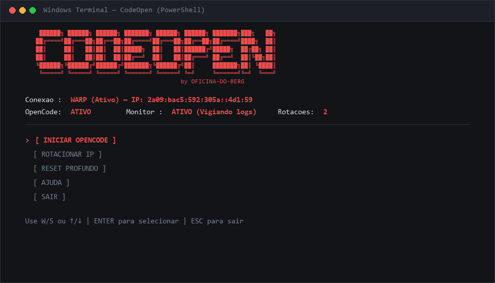
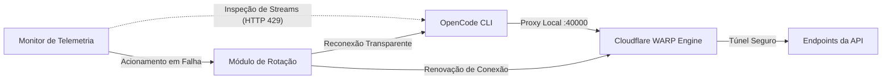

<div align="center">

# CodeOpenFreedom
### Gerenciador de Conectividade e Resiliência para OpenCode CLI
**Desenvolvido por OFICINA-DO-BERG**

<p align="center">
  <a href="https://github.com/Oficina-do-Berg/CodeOpenFreedom/blob/main/LICENSE">
    
  </a>
  
  
  
  
</p>

<p align="center">
  <a href="#visão-geral">Visão Geral</a> •
  <a href="#recursos-principais">Recursos Principais</a> •
  <a href="#comparativo-técnico">Comparativo</a> •
  <a href="#arquitetura-do-sistema">Arquitetura</a> •
  <a href="#instalação-e-requisitos">Instalação</a> •
  <a href="#guia-de-utilização">Uso</a> •
  <a href="#aviso-legal">Aviso Legal</a>
</p>

<br>

<p align="center">
  
</p>

</div>

---

## Visão Geral

O **CodeOpenFreedom** é uma camada de resiliência e gerenciamento de conectividade projetada para desenvolvedores que utilizam a interface de linha de comando do **OpenCode** em sistemas Windows.

Atuando de maneira transparente entre o terminal e as APIs externas, a ferramenta estabelece um túnel proxy local via **Cloudflare WARP (porta local 40000)**, monitora streams de telemetria em tempo de execução e mitiga interrupções provocadas por exaustão temporária de limites de requisição (HTTP 429), garantindo continuidade operacional ao fluxo de trabalho de engenharia de software.

---

## Recursos Principais

<table>
  <tr>
    <td width="50%" valign="top">
      <h4>Rotação Dinâmica de Conexão</h4>
      <p>Monitoramento contínuo de erros de resposta (como <code>HTTP 429</code>, <code>rate limit exceeded</code> ou <code>too many requests</code>). Ao detectar saturação, o subsistema orquestra a renovação de registro da sessão em aproximadamente 15 segundos sem encerrar o processo do terminal.</p>
    </td>
    <td width="50%" valign="top">
      <h4>Isolamento e Backup de Sessões</h4>
      <p>Procedimento de reinicialização controlada com salvaguarda preventiva. O banco de dados de sessões e conversas locais é arquivado com registro de data e hora (timestamp) em diretório dedicado antes de qualquer reset de estado operacional.</p>
    </td>
  </tr>
  <tr>
    <td width="50%" valign="top">
      <h4>Orquestração Automatizada</h4>
      <p>Elimina intervenções manuais de configuração de rede. A aplicação ajusta os parâmetros de modo proxy e alocação de portas locais de forma autônoma, validando a integridade das interfaces de rede antes da inicialização do serviço.</p>
    </td>
    <td width="50%" valign="top">
      <h4>Interface TUI Otimizada</h4>
      <p>Desenvolvida para alta responsividade no Windows Terminal e PowerShell nativo. Apresenta telemetria contínua com indicadores em tempo real de status da conexão, endereço IP em trânsito e estado de execução do daemon.</p>
    </td>
  </tr>
</table>

---

## Comparativo Técnico

A tabela abaixo sumariza as diferenças operacionais entre o fluxo padrão de execução do OpenCode CLI e a arquitetura gerenciada pelo CodeOpenFreedom:

| Cenário Operacional | Fluxo Padrão (Sem CodeOpenFreedom) | Com CodeOpenFreedom |
| :--- | :--- | :--- |
| **Exaustão de Taxa (HTTP 429)** | Processo bloqueado; requer espera indeterminada | Rotação automática de rota em ~15 segundos |
| **Saturação de Cota** | Interrupção manual do fluxo de desenvolvimento | Reset controlado com nova rota e histórico protegido |
| **Integridade de Dados** | Risco de perda de histórico em limpezas manuais | Backup estruturado automático com marcação temporal |
| **Configuração de Proxy** | Comandos manuais frequentes no console | Roteamento automático através da porta local 40000 |
| **Estabilidade Visual** | Terminais suscetíveis a flicker e concorrência | TUI assíncrona, suave e estável no Windows Terminal |

---

## Arquitetura do Sistema



---

## Instalação e Requisitos

### Pré-requisitos
* **Sistema Operacional:** Windows 10 ou Windows 11 (64-bit)
* **Python:** Versão 3.8 ou superior ([Download Python](https://www.python.org/downloads/))
* **Cloudflare WARP:** Cliente oficial instalado ([Download WARP](https://1.1.1.1/))
* **OpenCode CLI:** Instalado globalmente via npm (`npm install -g @opencode/cli`)

> [!IMPORTANT]
> **Etapa Obrigatória Antes de Executar o Script:**  
> Abra o aplicativo oficial do **Cloudflare WARP** no Windows e certifique-se de **ativá-lo (ligar a conexão)** antes de iniciar o CodeOpenFreedom. O script gerencia o tráfego a partir do daemon ativo do WARP para estabelecer o proxy local na porta 40000 e orquestrar as renovações de IP.

### Procedimento de Instalação

1. Clone o repositório localmente:
```cmd
git clone https://github.com/Oficina-do-Berg/CodeOpenFreedom.git
cd CodeOpenFreedom
```

2. Execute o instalador automatizado:
```cmd
INSTALAR.bat
```
> Alternativamente, instale as dependências via Python diretamente: `pip install -r requirements.txt`

---

## Guia de Utilização

### Inicialização

> [!NOTE]
> Lembre-se: o **Cloudflare WARP** deve estar aberto e **ligado (conectado)** no Windows antes de inicializar o aplicativo.

Para carregar o console interativo, execute o utilitário de entrada:
```cmd
INICIAR.bat
```
*(Ou execute `python main.py` através do seu emulador de terminal preferido).*

### Painel de Controle

```text
┌────────────────────────────────────────────────────────────┐
│                    CODEOPENFREEDOM                         │
│                   OFICINA DO BERG                          │
│                                                            │
│   Conexao: WARP (2a09:bac5:...) | OpenCode: ATIVO          │
├────────────────────────────────────────────────────────────┤
│                                                            │
│   > [ INICIAR OPENCODE ]  (ou [ PARAR OPENCODE ])          │
│     [ ROTACIONAR IP ]                                      │
│     [ RESET PROFUNDO ]                                     │
│     [ AJUDA ]                                              │
│     [ SAIR ]                                               │
│                                                            │
└────────────────────────────────────────────────────────────┘
```

### Controles de Navegação

| Tecla de Entrada | Ação Correspondente |
| :---: | :--- |
| **W** ou **Seta para Cima (↑)** | Desloca a seleção para o item superior |
| **S** ou **Seta para Baixo (↓)** | Desloca a seleção para o item inferior |
| **ENTER** | Confirma e executa o módulo selecionado |
| **ESC** | Encerra a aplicação de forma segura |

---

## Estrutura do Repositório

```text
CodeOpenFreedom/
├── assets/
│   └── terminal-preview.png # Amostra visual de alta definição da interface TUI
├── core/
│   ├── config.py            # Gerenciamento de parâmetros e persistência local
│   ├── connection.py        # Automação de interface de rede e Cloudflare WARP CLI
│   ├── opencode.py          # Gestão do ciclo de vida, arquivos de sessão e backups
│   ├── rotator.py           # Orquestrador de failover e rotação dinâmica de IP
│   ├── monitor.py           # Thread de observabilidade e captura de padrões de erro
│   └── orchestrator.py      # Controlador de processos e sincronização de eventos
├── utils/
│   ├── logger.py            # Subsistema de registro rotativo de eventos
│   └── helpers.py           # Utilitários de verificação de conectividade e rede
├── cli.py                   # Renderização e manipulação da interface TUI
├── main.py                  # Ponto de entrada da aplicação
├── select_language.py       # Seletor de idioma de inicialização (PT / EN)
├── INICIAR.bat              # Script executável de inicialização rápida
├── INSTALAR.bat             # Script de validação e instalação do ambiente Python
├── requirements.txt         # Especificação de dependências mínimas (psutil, requests)
├── test_sistema.py          # Script de testes e diagnóstico ambiental
├── test_reset.py            # Script de validação de rotinas de reset e backup
└── README.md                # Documentação técnica oficial
```

---

## Perguntas Frequentes

<details>
<summary><strong>Preciso abrir e ligar o Cloudflare WARP antes de iniciar o script?</strong></summary>
<br>
<strong>Sim, obrigatoriamente.</strong> O aplicativo do Cloudflare WARP deve estar aberto e conectado no Windows antes de você executar o script. O CodeOpenFreedom utiliza o daemon ativo do WARP para habilitar o proxy local na porta 40000 e efetuar as trocas automáticas de IP.
</details>

<details>
<summary><strong>É necessário configurar portas ou parâmetros de proxy manualmente?</strong></summary>
<br>
Não. O CodeOpenFreedom configura automaticamente os parâmetros de proxy local na porta 40000 e estabelece os vínculos de ambiente necessários. É requerido apenas que o cliente Cloudflare WARP esteja instalado na estação de trabalho e conectado.
</details>

<details>
<summary><strong>A rotina de Reset Profundo remove histórico ou sessões anteriores?</strong></summary>
<br>
Não de forma destrutiva. Antes de qualquer redefinição de tokens ou credenciais locais, o sistema realiza uma cópia integral do banco de dados de sessões para o diretório <code>Desktop\opencode_chats_archiviate\&lt;data_hora&gt;</code>, preservando seus dados.
</details>

<details>
<summary><strong>Qual emulador de terminal é recomendado para execução?</strong></summary>
<br>
Recomenda-se o uso do <strong>Windows Terminal</strong> (disponível gratuitamente na Microsoft Store), que oferece suporte integral a sequências de escape ANSI modernas, renderização acelerada por GPU e ausência de tremulação (flicker).
</details>

---

## Créditos

* **Desenvolvimento e Manutenção:** [OFICINA-DO-BERG](https://github.com/Oficina-do-Berg)
* **Base Conceitual:** Iniciativas de automação de fluxo OpenCode CLI

---

## Licença

Este projeto é distribuído sob os termos da licença **GPL-3.0**. Para detalhes completos sobre direitos de distribuição e modificação, consulte o arquivo [LICENSE](LICENSE).

---

## Aviso Legal

Este software é um utilitário independente e de código aberto desenvolvido com propósitos estritamente técnicos, educacionais e de gerenciamento de conectividade de rede local. Não possui qualquer vínculo institucional, patrocínio ou afiliação oficial com entidades gestoras de serviços externos citados. O operador é o único responsável pela utilização compatível com as diretrizes e termos de serviços pertinentes.
